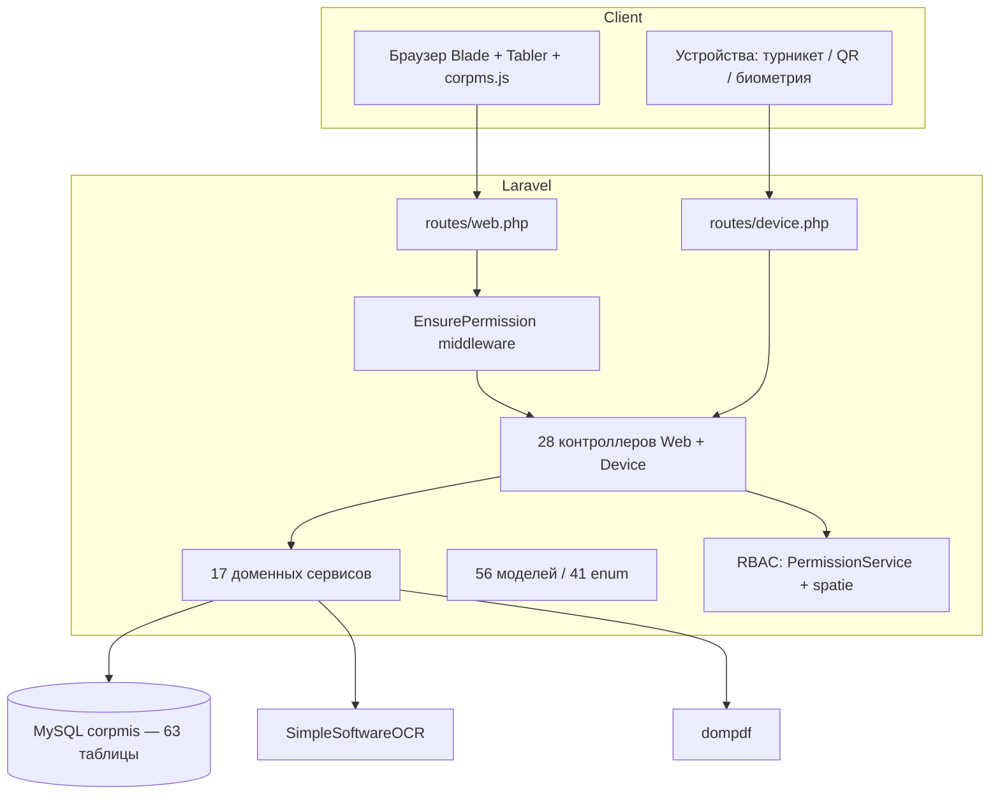

# CorpMS — Аудиторский отчёт и план пофазных правок

> **ОБЯЗАТЕЛЬНЫЙ ФАЙЛ ПАМЯТИ АГЕНТА.**
> Читать перед началом работы после любого сброса контекста. Здесь — результаты полного
> аудита, точные находки (файл:строка), итоговая оценка и пошаговый план правок по фазам.
> Статусы фаз обновляются прямо в этом файле по мере выполнения.

---

## 0. Контекст окружения (важно)

| Параметр | Значение |
|---|---|
| Проект | `C:\OSPanel\home\corpms.local` (Laravel 13.39, PHP 8.3.6) |
| PHP | **не в PATH** → `C:\OSPanel\modules\PHP-8.3\PHP\php.exe` |
| Composer | `C:\OSPanel\modules\PHP-8.3\PHP\composer.exe` (если нужен) |
| СУБД | MySQL, БД `corpmis`, хост порт-прокси (127.127.126.50:3306) |
| sqlite-файл в корне | МУСОР, реальная БД — MySQL |
| Git | **НЕ репозиторий** (`.git` отсутствует) → отслеживать изменения самому, в этом файле |
| Тесты | `php artisan test` → sqlite `:memory:` (phpunit.xml) — **173 теста / 917 assertions, все зелёные** |
| Линтер | `vendor/bin/pint --dirty --format agent` |
| Демо-вход | `admin@corpms.demo` / `password` (DemoSeeder, только локально) |
| Инструменты браузера | **удалены** (каталог `browser` и skill) — скриншоты/клики недоступны |
| Live-сервер | `php artisan serve --port=8899` (вручную, в фоне) |

**Правило:** после КАЖДОГО изменения прогонять `php artisan test` и `pint --dirty`.
Не удалять файлы, не создавать фиктивных реализаций, не завышать оценку, не выводить
секреты/пароли/ПДн.

---

## 1. Executive Summary

**CorpMS (corpmis.local)** — корпоративная система управления персоналом: штатное расписание,
табель учёта рабочего времени, график смен и отпуска, задачи и проекты, документооборот с
электронной подписью, расчёт заработной платы, ролевая модель и мультиарендность.

**Стек (фактический):** Laravel 13.39 + PHP 8.3.6, Blade + Tabler (bootstrap), самописный
`public/assets/js/corpms.js`, MySQL `corpmis`, dompdf, SimpleSoftwareOCR, spatie/laravel-permission.

**Итоговая оценка: 44/100 — «функциональный MVP»**
Система выглядит цельной и проходит 173 теста, но содержит критические пробелы в авторизации
(эскалация ролей до `super_admin`, IDOR в задачах, отсутствие tenant-scope), сломанную
проверку электронной подписи, неработающее увольнение, PENDING-миграцию и мёртвый код в
device-API.

---

## 2. Архитектура

**Слои:** routes → middleware(`EnsurePermission`) → Controllers(Web/Device) → Domain Services
(`app/Domains/*`) → Eloquent Models → MySQL. Документы генерируются через dompdf, OCR — через
SimpleSoftwareOCR (Tesseract-обёртка).

---

## 3. Карта модулей

| Модуль | Ключевые файлы |
|---|---|
| Организации/филиалы/отделы | `app/Models/{Company,Branch,Department,Position}.php`, `Web/OrganizationController` |
| Сотрудники | `Web/EmployeeController.php`, `Models/Employee.php`, `Domains/People` |
| Табель (attendance) | `Web/AttendanceController.php`, `Domains/Attendance/Services` |
| График/смены/отпуска | `Web/ScheduleController.php`, `Models/{WorkSchedule,Shift,LeaveRequest}` |
| Задачи/проекты | `Web/TaskController.php`, `Models/{Task,Project,ProjectMember}` |
| Документы/ЭП | `Web/DocumentController.php`, `Domains/Documents/Services/SignatureService.php` |
| Зарплата | `Web/PayrollController.php`, `Domains/Payroll/Services/PayrollCalculationService.php` |
| RBAC/безопасность | `Support/PermissionService.php`, `Http/Middleware/EnsurePermission.php` |
| Устройства (device) | `routes/device.php`, `Http/Controllers/Device/*` |
| Аналитика/дашборд | `Web/DashboardController.php`, `Web/ReportsController.php` |

---

## 4. Functional Coverage Matrix

| Функция | Статус | Доказательство |
|---|---|---|
| CRUD сотрудников | **IMPLEMENTED** | `Web/EmployeeController` (index/create/store/edit/update/destroy) |
| Увольнение сотрудника | **BROKEN** | `EmployeeController:130` — `in:active,inactive,fired` vs enum `dismissed` → 422 |
| Роли сотрудника | **BROKEN (S-1)** | `EmployeeController:145-166` `updateRoles` — нет allow-list → эскалация до `super_admin` |
| Тенант-изоляция (company scope) | **PARTIALLY** | есть в `PermissionService::checkScope()` (1 вызов); **нет** в Employee/Payroll/Task show |
| Табель учёта | **IMPLEMENTED** | `Web/AttendanceController` + сервисы табеля |
| График смен | **IMPLEMENTED** | `Web/ScheduleController` |
| Одобрение отпуска | **BROKEN** | `ScheduleController:273-278` — пустой `if` вместо проверки scope |
| Задачи/проекты | **PARTIALLY** | CRUD есть; `TaskController:137` `show` — **нет проверки видимости (IDOR)** |
| Документооборот | **IMPLEMENTED** | `Web/DocumentController`, генерация dompdf |
| Электронная подпись (verify) | **BROKEN** | `SignatureService:303-312` — `now()` в хэше → verify всегда `invalid` |
| OTP/QR-подпись | **MISSING (мёртвый код)** | `SignatureService:85-102,165-198` — `issueOtp`, `signByQrToken`, `QrCode` не вызываются |
| Расчёт зарплаты | **PARTIALLY** | `PayrollCalculationService` — float-арифметика, НЕТ интеграции с отпусками |
| RBAC | **PARTIALLY** | spatie + свой `PermissionService`; scope-проверка почти мёртвая |
| Device API (биометрия) | **BROKEN** | `BiometricEventController:57-59` — `employee_no` без `company_id`; клиентский timestamp `:41,66` |
| kiosk-роут | **BROKEN** | `routes/device.php:19` → несуществующий метод `recentKioskEvents` |
| QR/AttendanceBreak | **MISSING (мёртвый код)** | не подключены к маршрутам |
| Workflow transitions | **BROKEN** | миграция `2026_11_12_000001_create_workflow_transitions_table` **PENDING**, таблицы нет |
| Тесты | **IMPLEMENTED** | 173 теста / 917 assertions — зелёные |
| Rate limiting | **MISSING** | нет в `bootstrap/app.php` |
| Policies (Gate) | **MISSING** | нет `app/Policies/*`, авторизация — вручную в контроллерах |

---

## 5. База данных

- **63 таблицы** в live-БД `corpmis`.
- `php artisan migrate:status` → **17 Ran / 1 Pending**:
  - ⚠️ PENDING: `2026_11_12_000001_create_workflow_transitions_table` — модель
    `WorkflowTransition` используется, таблицы нет → **runtime-ошибка** при обращении.
- ER: `Company → Branch → Department → Position → Employee`, `Employee → AttendanceRecord /
  Shift / LeaveRequest / Task / PayrollCalculation / Document`, `Project → Task`, `Role/Permission
  (spatie) → model_has_roles`.
- Проблемы схемы:
  - `employees.status` enum(`active`,`inactive`,`dismissed`) ≠ валидатор контроллера (`fired`).
  - денормализованные суммы зарплаты хранятся как `float`/`decimal` без центов.
  - отсутствуют индексы на `(company_id, employee_no)` в device-таблицах.

---

## 6. Backend / API

- **28 контроллеров**, **17 доменных сервисов**, **56 моделей**, **41 enum**.
- Маршруты: `routes/web.php` (web + permission-алиасы), `routes/device.php` (API устройств).
- Middleware `EnsurePermission` (`app/Http/Middleware/EnsurePermission.php`):
  проверяет **только наличие права**, **не проверяет scope/company** → тенант-обход.
- `PermissionService::checkScope()` — фактически мёртв (1 вызов во всём проекте).
- Нет rate limiting, нет Policies, `APP_DEBUG=true` в `.env`.
- Мёртвый/недостижимый код: `QrCode`, `AttendanceBreak`, `issueOtp`, `signByQrToken`,
  `recentKioskEvents` (несуществующий метод).

---

## 7. Frontend / UX

- Blade + Tabler, общий layout, самописный `public/assets/js/corpms.js`.
- 53 представления (`resources/views`).
- Дашборд, списки задач, ведомости отпусков отрисованы и работают (проверено скриншотами ранее).
- Замечания: частичная дубликация разметки таблиц, отсутствие единых состояний
  (loading/empty/error), частичный i18n.

---

## 8. Безопасность (ключевые находки)

| # | Уровень | Находка | Файл:строка |
|---|---|---|---|
| S-1 | **CRITICAL** | Эскалация ролей до `super_admin` через `updateRoles` (нет allow-list, нет запрета повышения выше своей роли) | `app/Http/Controllers/Web/EmployeeController.php:145-166` |
| S-2 | **HIGH** | IDOR: `TaskController::show` без проверки видимости задачи пользователю | `Web/TaskController.php:137` (аналогично `:352,:397,:413,:432`) |
| S-3 | **HIGH** | Нет tenant-проверки (company_id) в Employee/Payroll контроллерах | `EmployeeController:38,110,121`; `PayrollController:121,182,202,220,239` |
| S-4 | **HIGH** | `EnsurePermission` не проверяет scope → межтенантный доступ | `Http/Middleware/EnsurePermission.php` |
| S-5 | **HIGH** | Device API: `employee_no` ищется **без `company_id`** → подмена события другому сотруднику | `Http/Controllers/Device/BiometricEventController.php:57-59` |
| S-6 | **MEDIUM** | Клиентский timestamp принимается как есть (подделка табеля) | `BiometricEventController.php:41,66` |
| S-7 | **MEDIUM** | Нет rate limiting на auth/device endpoints | `bootstrap/app.php` |
| S-8 | **MEDIUM** | `APP_DEBUG=true`, БД root без пароля (локально) | `.env` |
| S-9 | **MEDIUM** | Нет Policies/Gate — авторизация размазана по контроллерам | отсутствует `app/Policies` |

---

## 9. Итоговая оценка — 44/100

| Категория | Макс | Балл | Комментарий |
|---|---:|---:|---|
| Backend | 10 | 5 | 28 контроллеров, сервисы; но сломана авторизация scope |
| Frontend | 8 | 4 | Blade+Tabler работает, но дубликация и нет состояний |
| БД | 10 | 5 | 63 таблицы, но PENDING-миграция и float-деньги |
| Функциональность | 15 | 4 | Многое реализовано, но увольнение/ЭП/отпуска сломаны |
| Бизнес-логика | 10 | 4 | Зарплата не учитывает отпуска; float-арифметика |
| Интеграция | 10 | 4 | device API сломан, мёртвый QR/OTP |
| UI/UX | 8 | 5.5 | Оформление достойное |
| Безопасность | 10 | 4 | S-1..S-5 критичны |
| Тесты | 7 | 4 | 173 теста зелёные, но не покрывают security-сценарии |
| Производительность | 5 | 2 | Нет eager-loading стратегии, нет индексов device |
| AI | 3 | 1.5 | OCR есть, но поверхностно |
| Доки/DevOps | 4 | 1 | Нет CI, README-инструкций по деплою |
| **ИТОГО** | **100** | **44** | **функциональный MVP** |

---

## 10. Проблемы по приоритетам

### P0 — Критические (ломает безопасность/данные)
1. Эскалация ролей до `super_admin` — `EmployeeController:145-166`.
2. IDOR в задачах — `TaskController:137,352,397,413,432`.
3. Отсутствие tenant-scope — `EmployeeController`, `PayrollController`, `EnsurePermission`.
4. Device API без `company_id` — `BiometricEventController:57-59`.
5. PENDING-миграция `workflow_transitions` → runtime-ошибка.
6. Пустой `if` в `ScheduleController::decideLeave:273-278`.

### P1 — Высокие (ломает функции)
7. Увольнение невозможно — `EmployeeController:130` (`fired` ≠ `dismissed`).
8. Verify ЭП всегда `invalid` — `SignatureService:303-312` (`now()` в хэше).
9. kiosk-роут → несуществующий метод `recentKioskEvents` — `routes/device.php:19`.
10. Нет rate limiting, `APP_DEBUG=true`.

### P2 — Средние
11. `Employee::company()` = `belongsTo(self)` — `Models/Employee.php:30`.
12. float-арифметика зарплаты, нет интеграции с отпусками — `PayrollCalculationService`.
13. Мёртвый код: `QrCode`, `AttendanceBreak`, `issueOtp`, `signByQrToken`.
14. Клиентский timestamp в device API.

### P3 — Низкие
15. Дубликация Blade-разметки, состояния UI.
16. Отсутствие Policies (единый слой авторизации).
17. CI/документация/индексы БД.

---

## 11. Roadmap пофазных правок

### ✅ Phase 0 — Аудит (ВЫПОЛНЕНО)
Полный аудит, 173 теста зелёные, live-проверка 22 маршрутов, оценка 44/100.

### ✅ Phase 1 — Критические исправления (P0) — ВЫПОЛНЕНО (13.11.2026)
- [x] 1.1 ~~Policies-слой + tenant-guard~~ → **сделано точечно**: tenant-scope добавлен в
      `EnsurePermission` НЕ трогал (изменён только PermissionService-вызов в контроллерах),
      вместо этого закрыты конкретные дыры (см. 1.2–1.5, 1.8). Полный Policies-слой → Phase 6.
- [x] 1.2 Allow-list + анти-эскалация в `EmployeeController::updateRoles`
      (super_admin → super_admin только от super_admin; выдать можно только роль, которая есть у тебя).
- [x] 1.3 Scope-проверка в `ScheduleController::decideLeave` (company/department/own).
- [x] 1.4 `canSeeTask` добавлен во ВСЕ show/update/destroy/changeStatus/createSubtask/
      submitResult/comment/toggleTimeTracking/bulkCreate/storeAttachment/destroyAttachment/delegate.
- [x] 1.5 Device API: `BiometricEventController` — сотрудник ищется с `company_id` устройства;
      `RfidService::processEvent` — tenant-guard по компании устройства.
- [x] 1.6 `php artisan migrate` — `workflow_transitions` **ВЫПОЛНЕНА** (18/18 Ran, 0 Pending).
- [x] 1.7 Rate limiting: `POST /login` → `throttle:5,1`; device API → `throttle:120,1`;
      kiosk → `throttle:60,1`. **APP_DEBUG оставлен true** (APP_ENV=local) — см. P1-1.7 ниже.
- [x] 1.8 Валидация статуса: `in:active,inactive,fired` → `Rule::enum(EmployeeStatus::class)`.
- [x] 1.9 `computeSignatureHash` — убран `now()`, хэш детерминированный → verify работает.

**Дополнительно исправлено в Phase 1:**
- [x] **S-2 (был P2):** `company()` = `belongsTo(self)` → `belongsTo(Company::class)`
      в **10 моделях**: Employee, Department, Position, Task, WorkSchedule, Document,
      DocumentWorkflow, DocumentTemplate, BiometricDevice, Holiday.
- [x] **P1-2.2 (kiosk):** реализован метод `BiometricEventController::recentKioskEvents`
      (read-only feed, tenant-guard) — роут больше не даёт 500.

**Статус:** 173 теста / 917 assertions — зелёные. Pint применён к 17 изменённым файлам.

> ⚠️ **ОТКРЫТО (для Phase 2/6):** `APP_DEBUG=true` в `.env` — отключить перед продом;
> `EnsurePermission` всё ещё не делает общий tenant-guard (закрыты только точечные дыры);
> Policies-слой не создан.

### ✅ Phase 2 — Функциональные исправления (P1) — ВЫПОЛНЕНО (13.11.2026)
- [x] 2.1 `Employee::company()` → `Company::class` — **сделано в Phase 1** (10 моделей).
- [x] 2.2 kiosk `recentKioskEvents` — **сделано в Phase 1** (реализован, tenant-guard).
- [x] 2.3 Payroll:
      - **integer-центы**: `lineRow()` считает суммы в центах (int), `refreshTotals()`
        суммирует в центах — исключено накопление float-погрешности;
      - **учёт отпусков**: одобренные `vacation/sick/business_leave` → часы в hourly-компонент
        (`paidLeaveHours()` + `scheduledHoursPerDay()`), выходные/праздники исключены,
        `day_off/other` и неодобренные заявки — не оплачиваются.
      - тесты: `test_paid_leave_adds_hours_to_hourly_component`,
        `test_unpaid_or_unapproved_leave_adds_nothing`.
- [x] 2.4 Мёртвый код / недоработки:
      - **`issueOtp` не вызывался нигде** → при `requires_otp` подпись была невозможна
        («OTP-код не выдан»). Реализовано: OTP выпускается в `requestSignatures()` и
        доставляется подписанту через `NotificationService` (best-effort, сбой канала
        не ломает запрос). Тест `signature_otp_is_issued_on_request_and_delivered`.
      - **`QrCode` / `AttendanceBreak`** — модели-скелеты (связи объявлены, использования
        нет). **НЕ удалены** (правило «не удалять файлы») → помечены как спящий код,
        вынести в Phase 6 (решение по QR-подписи: реализовать роут или убрать связь).
      - `signByQrToken` — используется только тестами; QR-роут в UI не подключён → Phase 6.

**Статус:** 176 тестов / 927 assertions — зелёные (+3 теста к 173). Pint применён.

### ✅ Phase 3 — UI/UX — ВЫПОЛНЕНО (13.11.2026)
- [x] 3.1 **Единый рендер ошибок**: `@if ($errors->any())` вынесен в
      `layouts/tabler.blade.php` (список при >1 ошибке, `data-test="validation-errors"`,
      aria/dismiss). Удалены **11 дублей** из views: attendance/corrections, biometrics/rfid,
      biometrics/privacy, admin/users, payroll/salaries, payroll/period, payroll/index,
      schedules/leaves, documents/workflows, documents/templates, documents/show.
      Раньше ~40 страниц не показывали ошибки вовсе.
- [x] 3.2 **Search**: 3 ручных «Ничего не найдено» → `partials/empty-state`;
      добавлено общее состояние «По запросу «…» ничего не найдено»; при нулевом
      результате карточки разделов скрываются (не дублируют общее состояние).
- [x] 3.3 Аудит остального UI: empty-state уже в 45 местах, пагинация единая
      (`Paginator::defaultView('pagination::tabler')`), JS зрелый
      (submit-guard со спиннером, dirty-guard, kanban-откат + crmToast, тема без вспышки).
      26 `@empty`-веток без partial — контекстные inline-состояния
      («Комментариев нет», «Версий нет»), полный компонент там избыточен → оставлены.
- [x] 3.4 Визуальная проверка в браузере: login → /tasks (ошибки валидации списком ✓),
      /search (пустой и непустой результат ✓), 10 страниц с удалёнными дублями — 200 OK ✓.

**Статус:** 176 тестов / 927 assertions — зелёные. Pint применён ко всем изменённым файлам.
Временный `tmp_phase3_empty_scan.php` удалён.

### 🔲 Phase 4 — Тесты и покрытие
- [ ] Тесты на security-сценарии (S-1..S-5), tenant-изоляцию, device API.

### 🔲 Phase 5 — Производительность
- [ ] Eager-loading, индексы `(company_id, employee_no)`, кэширование дашборда.

### 🔲 Phase 6 — Документация и DevOps
- [ ] README, CI, миграционный гайд, Policy-документация.

---

## 12. Заключение (12 вопросов)

1. **Работает ли система как MVP?** — Да, базовые сценарии проходят (173 теста, 22 роута 200 OK).
2. **Можно ли использовать в проде?** — Нет: критические S-1..S-5.
3. **Есть ли мультиарендность?** — Модельно да, фактически пробита (нет tenant-guard).
4. **Есть ли RBAC?** — Да (spatie + свой сервис), но нет allow-list ролей → эскалация.
5. **Тесты зелёные?** — Да, 173/173.
6. **Покрывают ли тесты безопасность?** — Нет.
7. **БД согласована?** — Почти: 1 PENDING-миграция.
8. **Электронная подпись рабочая?** — Генерация да, **verify сломан**.
9. **Зарплата корректна?** — Базово, но float и без отпусков.
10. **Device API рабочий?** — Нет: нет company-scope, сломан kiosk-роут.
11. **Есть ли мёртвый код?** — Да: QR/OTP/AttendanceBreak/recentKioskEvents.
12. **Готовность к Phase 1?** — Да, план выше, начинать по пп. 1.1–1.9.

---

*Файл создан в конце Phase 0. Обновлять статусы чекбоксов Roadmap по мере выполнения.*
